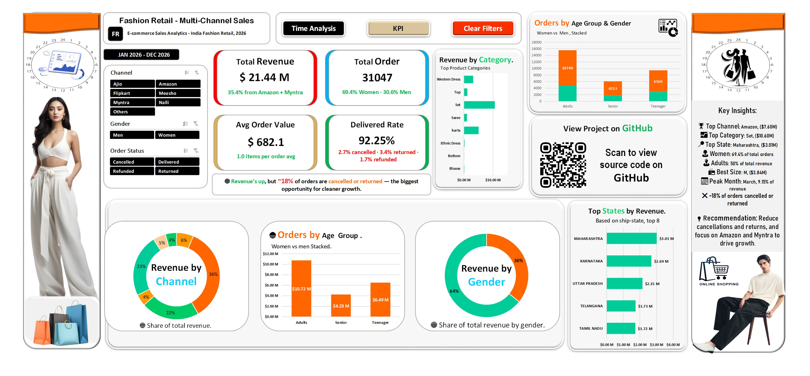
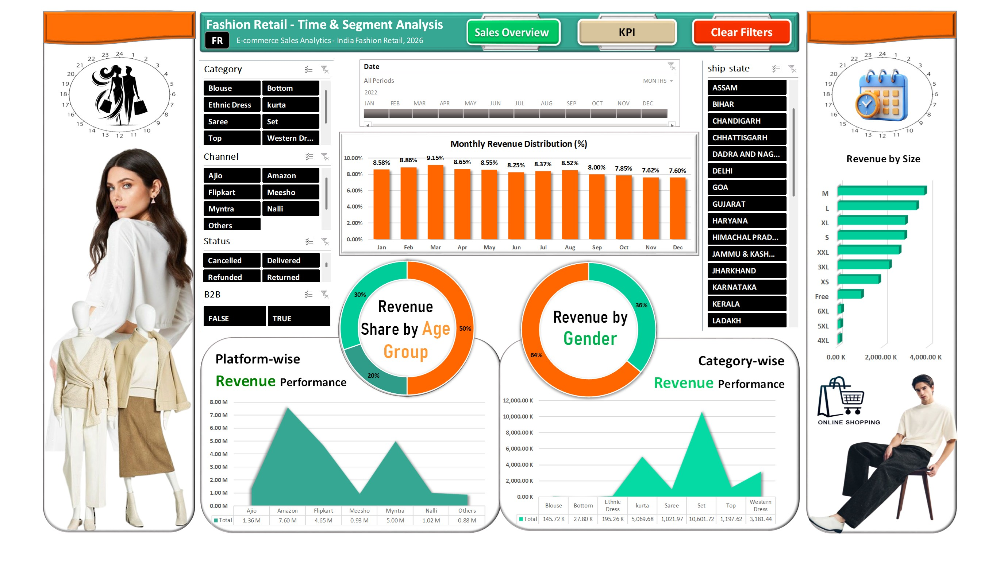
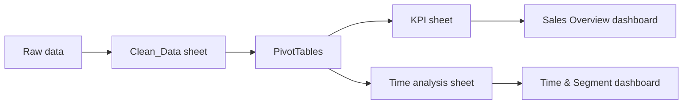

<div align="center">

# Fashion Retail Multi-Channel Sales Analysis (Excel)

**Which channels, categories, customers and states drive revenue, and where is revenue leaking through cancellations and returns?**


</div>

---

## Dashboard Preview

**Page 1: Sales Overview & KPIs**



**Page 2: Time & Segment Analysis**



---

## Table of Contents

1. [Business Problem](#business-problem)
2. [Executive Summary](#executive-summary)
3. [Data](#data)
4. [Data Cleaning & Preparation](#data-cleaning--preparation)
5. [Methodology](#methodology)
6. [Key Findings](#key-findings)
7. [Recommendations](#recommendations)
8. [Limitations & Next Steps](#limitations--next-steps)
9. [Repository Structure](#repository-structure)
10. [About the Author](#about-the-author)

---

## Business Problem

An online fashion retailer sells through seven marketplaces across India. Management needs a single view that answers:

- Which **channels** and **product categories** generate the most revenue?
- Which **customer segments** (gender, age group) buy the most?
- Which **states** are the strongest markets?
- How does revenue change **month by month**?
- How much revenue is lost to **cancelled, returned and refunded** orders?

This project turns the raw order data into an interactive, two-page Excel dashboard that answers these questions with a few clicks.

---

## Executive Summary

| Metric | Value |
|---|---|
| **Total Revenue** | ₹21.44 M |
| **Total Orders** | 31,047 |
| **Average Order Value** | ₹682 |
| **Delivered Rate** | 92.25% |
| **Top Channel** | Amazon (₹7.60 M, 35.4%) |
| **Top Category** | Set (₹10.60 M, 49.4%) |
| **Top State** | Maharashtra (₹3.01 M, 14.0%) |
| **Peak Month** | March (9.15% of annual revenue) |

**In one line:** revenue is concentrated in three channels and three categories, women drive most orders, and about 1 in 13 orders never completes.

---

## Data

| Item | Detail |
|---|---|
| Dataset | Vrinda Store fashion e-commerce sales (India) |
| Source | [add source link] |
| Period | January – December 2022 |
| Records | 31,047 orders |
| Currency | INR (₹) |
| Channels | Ajio, Amazon, Flipkart, Meesho, Myntra, Nalli, Others |
| Categories | Blouse, Bottom, Ethnic Dress, Kurta, Saree, Set, Top, Western Dress |

**Main fields:** Order ID, Customer ID, Gender, Age, Age Group, Date, Month, Status, Channel, Category, Size, Qty, Amount, Revenue, Ship City, Ship State, B2B.

---

## Data Cleaning & Preparation

Work was done in the `Clean_Data` sheet of the workbook.

- Structured the raw order data into one clean table (one row per order)
- Added **Month** and **Age Group** (Teenager, Adults, Senior) columns for time and segment analysis
- Defined a **Revenue** field from order `Amount` for all KPI calculations
- <!-- CONFIRM: list your real steps, e.g. removed duplicates, fixed text case, handled blanks -->
- Validated totals: every pivot reconciles to the same grand total of **₹21,441,209**

The raw file is kept unchanged in the repo so every step can be traced.

---

## Methodology



- **PivotTables** for every KPI and chart, grouped across KPI and Time analysis sheets
- **Slicers** (Channel, Gender, Order Status, Category, Ship State, B2B) connected across both pages
- **Timeline slicer** for date filtering
- **Formulas** for KPI cards (Average Order Value, Delivered Rate, share percentages)
- **Navigation buttons** between pages and a **Clear Filters** button
- **Charts:** donut, stacked column, bar, area and column charts

---

## Key Findings

### 1. Revenue depends on three channels
Amazon (35.4%), Myntra (23.3%) and Flipkart (21.7%) together bring in **80.4%** of revenue. Ajio, Nalli, Meesho and Others share the remaining 19.6%.

### 2. Three categories generate 88% of revenue
Set (49.4%), Kurta (23.6%) and Western Dress (14.8%) lead. Bottom, Blouse and Ethnic Dress each contribute **under 1%**.

### 3. Women are the core customer
Women place **69.4%** of orders and generate **64%** of revenue. Men's share of revenue (36%) is higher than their share of orders, so men spend more per order.

### 4. Adults lead, teenagers are a strong second
Adults generate 50.0% of revenue, teenagers 30.3% and seniors 19.7%.

### 5. Five states bring in over half of revenue
Maharashtra (₹3.01 M), Karnataka (₹2.69 M), Uttar Pradesh (₹2.15 M), Telangana (₹1.73 M) and Tamil Nadu (₹1.72 M) account for **52.7%**.

### 6. Revenue peaks in March, then slows
March is the strongest month (9.15%). Revenue share then falls steadily from September to **7.60% in December**, about 17% below the March peak.

### 7. About 8% of orders do not complete
92.25% of orders are delivered. The rest are cancelled (2.7%), returned (3.4%) or refunded (1.7%). Calculated on revenue value, delivered orders account for 93.1% of revenue, so roughly **₹1.48 M** sits in cancelled, returned or refunded orders.

---

## Recommendations

1. **Protect the top three channels** (Amazon, Myntra, Flipkart) with stock availability and promotions, since they carry 80% of revenue.
2. **Double down on Set and Kurta**, and review whether Bottom, Blouse and Ethnic Dress are worth their catalogue space or need repositioning.
3. **Target women first** (core customers), and test men's campaigns, since men already spend more per order.
4. **Prioritise Maharashtra, Karnataka and Uttar Pradesh** for logistics and regional offers.
5. **Plan inventory and campaigns around the March peak**, and run a second-half sales push to offset the September–December decline.
6. **Cut the cancellation and return rate.** Even a one-point improvement recovers revenue without adding any new customers.

---

## Limitations & Next Steps

- Data covers **one year**, so year-over-year growth cannot be measured.
- The dataset has **no cost or margin data**, so the analysis shows revenue, not profit.
- Total revenue is **gross**: it includes cancelled, returned and refunded orders.
- Customer-level analysis (repeat purchase, lifetime value) was not part of this scope.

**Next steps:** add cost data for profitability, build an RFM customer segmentation, and rebuild the dashboard in Power BI for comparison.

---

## Repository Structure

```
Fashion_Retail_Multi_Channel_Sales_Analysis_20261011_V01/
├── README.md
├── Fashion_Retail_Sales_Dashboard_20261011_V01.xlsx   # Clean data + PivotTables + dashboards
├── Fashion_Retail_Raw_Data_20261011_V01.xlsx          # Original, unchanged
├── Fashion_Retail_Dashboard_Page1_20261011_V01.jpg
└── Fashion_Retail_Dashboard_Page2_20261011_V01.jpg
```

**Workbook sheets:** `KPI` · `Sales Overview` · `Clean_Data` · `Time analysis`

**How to use:** download the `.xlsx`, open it in Excel (desktop recommended for slicers), and click the slicers to filter. Use **Clear Filters** to reset.

---

## About the Author

**Shanto Islam**, Data Analyst
Excel · PivotTables · Dashboard Design · Data Cleaning

[GitHub](https://github.com/shanto-islam-analytics) · [LinkedIn](https://www.linkedin.com/in/shanto85206/?lipi=urn%3Ali%3Apage%3Ad_flagship3_profile_view_base_contact_details%3B3AIw9HbmT%2BSVG8dCn8cskw%3D%3D)

If you found this project useful, please give it a ⭐
